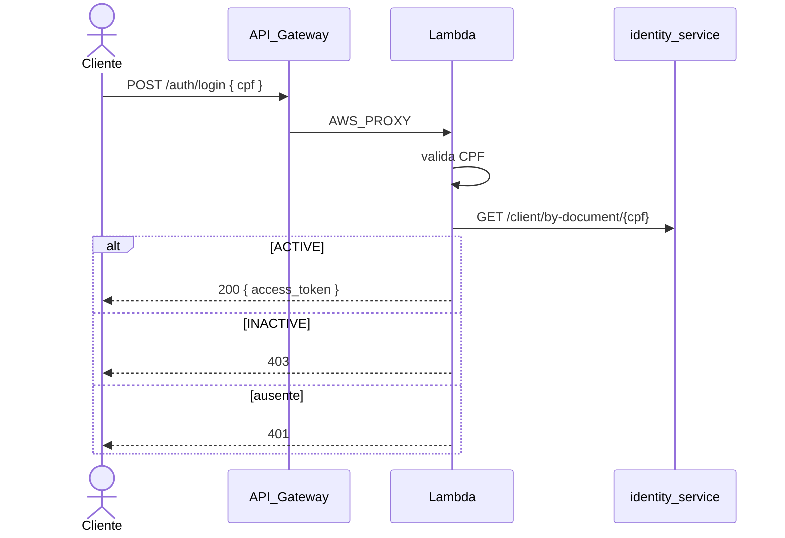

# lambda-auth — autenticação por CPF

Function serverless da Fase 3. O avaliador testa assim:

```bash
curl -X POST https://b831ifscuh.execute-api.us-east-1.amazonaws.com/prod/auth/login \
  -H "Content-Type: application/json" \
  -H "x-request-id: avaliacao-1" \
  -d '{"cpf":"52998224725"}'
```

Resposta esperada: `200` e `{ "access_token": "..." }`. CPF inválido → `400`. Cliente inexistente → `401`. Inativo → `403`.

A API da oficina (Swagger) **não** está neste repo: http://k8s-techchal-api-3be88fc582-917637512.us-east-1.elb.amazonaws.com/api

## Propósito

Function serverless que autentica o **cliente** da oficina (CPF). Expõe `POST /auth/login` no API Gateway HTTP: valida o CPF, consulta o **identity-service** (`GET /client/by-document/:cpf`) e devolve um JWT (`role: cliente`). Login de funcionários fica no identity (`POST /auth/login` email+senha via ALB).

## Tecnologias

- Node.js 20, TypeScript, esbuild
- AWS Lambda + API Gateway HTTP (v2)
- HTTP para o identity-service (`IDENTITY_BASE_URL`)
- `cpf-cnpj-validator`, `jsonwebtoken`
- Terraform >= 1.5
- Layer New Relic (quando a license key existe)

Não há Dockerfile: o artefato é zip de `dist/`, runtime `nodejs20.x`.

## Pré-requisitos

1. `infra-kubernetes` com identity no ALB (`/identity`)
2. GitHub Secrets: `AWS_ACCESS_KEY_ID`, `AWS_SECRET_ACCESS_KEY`, `AWS_SESSION_TOKEN`, `IDENTITY_BASE_URL` (ex. `http://<alb-dns>/identity`), `JWT_SECRET`
3. Opcionais: `NEW_RELIC_LICENSE_KEY`, `NEW_RELIC_ACCOUNT_ID`

O `JWT_SECRET` tem de ser o mesmo do identity/MS. Payload: `sub` = `id` do cliente, `email`, `role: "cliente"`.

## Execução

```bash
npm ci
npm run build
./scripts/tf-init.sh
cd terraform/environments/prod
terraform plan
terraform apply
```

## Deploy

Push na `main` roda [`Deploy Prod`](.github/workflows/deploy-prod.yml): build, `terraform apply`, smoke `POST /auth/login`.

## Ordem de deploy

1. infra-database (+ databases MS)
2. infra-kubernetes (MS + SNS/SQS)
3. identity-service no EKS
4. lambda-auth

## Pipeline

| Workflow | Gatilho | O que faz |
|---|---|---|
| [`terraform-plan.yml`](.github/workflows/terraform-plan.yml) | PR para `main` | build, `fmt`, `validate`, `plan` |
| [`deploy-prod.yml`](.github/workflows/deploy-prod.yml) | push na `main` | build, `apply`, curl no login |

A `main` é protegida.

## Diagrama deste repositório



## Deploy ativo (produção)

- API Gateway: `POST` https://b831ifscuh.execute-api.us-east-1.amazonaws.com/prod/auth/login
- CPF de demonstração (cliente `ACTIVE` no seed): `52998224725`
- API protegida / Swagger: http://k8s-techchal-api-3be88fc582-917637512.us-east-1.elb.amazonaws.com/api

## APIs

- Contrato: `POST /auth/login` `{ "cpf": "52998224725" }` → `{ "access_token": "..." }`
- Header de correlação: envie e receba `x-request-id`
- Sem token nas rotas internas da API: `401`. Com JWT de `role=cliente` em rota de equipe: `403` (token válido, papel insuficiente).

```bash
API_URL=$(terraform -chdir=terraform/environments/prod output -raw api_gateway_url)
curl -X POST "${API_URL}/auth/login" \
  -H "Content-Type: application/json" \
  -H "x-request-id: demo-login-1" \
  -d '{"cpf":"52998224725"}'
```
